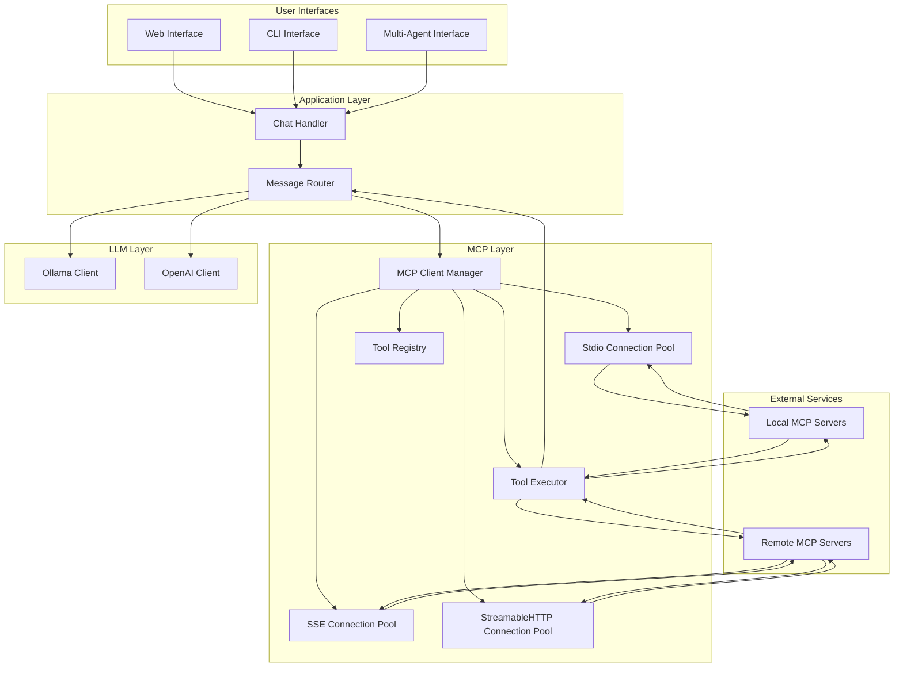

# MCP Integration Plan for ollama-js

## Executive Summary

This document outlines the architecture and implementation plan for integrating Model Context Protocol (MCP) server connectivity into the ollama-js project. The integration will enable LLMs to call external tools and services through MCP servers, augmenting their capabilities.

## Current State Analysis

### Existing Interfaces
- **web-interface.js**: Express + WebSocket server for web-based chat
- **chat-interface.js**: CLI chat interface (Ollama only)
- **hybrid-chat-interface.js**: CLI chat interface (Ollama + OpenAI)
- **multi-agent-chat.js**: Multi-agent conversations
- **puter-chat-interface.js**: Puter API chat interface

### Existing Configuration
- **mcp-config.json**: Already contains MCP server configurations with stdio-based servers
  - MCP_DOCKER: Docker-based MCP gateway
  - Tabby MCP: npx-based Tabby MCP server

### Current Dependencies
```json
{
  "axios": "^1.13.2",
  "dotenv": "^17.2.3",
  "express": "^5.2.1",
  "ollama": "^0.5.11",
  "openai": "^4.0.0",
  "ws": "^8.18.3"
}
```

## MCP Protocol Overview

### What is MCP?
MCP (Model Context Protocol) is an open protocol that enables LLMs to connect to external tools and data sources. It provides:
- Standardized tool discovery and invocation
- Bidirectional communication between LLMs and tools
- Support for both stdio and SSE (Server-Sent Events) transport
- JSON-RPC 2.0 message format

### MCP Message Flow

**Stdio Transport (Local MCP Servers):**
```
┌─────────────┐         ┌─────────────┐         ┌─────────────┐
│   LLM       │────────▶│   Client    │────────▶│  MCP Server │
│ (Ollama/   │  Tool   │  (This App) │  JSON-RPC│  (Local)    │
│  OpenAI)    │◀────────│             │◀────────│  (stdio)    │
└─────────────┘  Result  └─────────────┘  Result  └─────────────┘
```

**SSE Transport (Remote MCP Servers):**
```
┌─────────────┐         ┌─────────────┐         ┌─────────────┐
│   LLM       │────────▶│   Client    │────────▶│  MCP Server │
│ (Ollama/   │  Tool   │  (This App) │  JSON-RPC│  (Remote)   │
│  OpenAI)    │◀────────│             │◀────────│  (HTTP/SSE) │
└─────────────┘  Result  └─────────────┘  Result  └─────────────┘
```

**StreamableHTTP Transport (Remote MCP Servers):**
```
┌─────────────┐         ┌─────────────┐         ┌─────────────┐
│   LLM       │────────▶│   Client    │────────▶│  MCP Server │
│ (Ollama/   │  Tool   │  (This App) │  JSON-RPC│  (Remote)   │
│  OpenAI)    │◀────────│             │◀────────│  (HTTP/Stream)│
└─────────────┘  Result  └─────────────┘  Result  └─────────────┘
```

### MCP JSON-RPC Methods
- `initialize`: Initialize connection
- `tools/list`: List available tools
- `tools/call`: Execute a tool
- `resources/list`: List available resources
- `resources/read`: Read a resource
- `prompts/list`: List available prompts
- `prompts/get`: Get a prompt

## Architecture Design

### High-Level Architecture



### Component Breakdown

#### 1. MCP Client Manager (`lib/mcp-client-manager.js`)
**Responsibilities:**
- Load and parse mcp-config.json
- Initialize MCP server connections
- Manage connection lifecycle (connect, disconnect, reconnect)
- Provide interface for tool discovery and execution

**Key Methods:**
```javascript
class MCPClientManager {
  async initialize(configPath)
  async connectToServer(serverName)
  async disconnectFromServer(serverName)
  async listTools(serverName)
  async callTool(serverName, toolName, arguments)
  async listResources(serverName)
  async readResource(serverName, uri)
  getConnectedServers()
  getServerStatus(serverName)
}
```

#### 2. Stdio Connection Pool (`lib/stdio-connection-pool.js`)
**Responsibilities:**
- Manage active stdio connections to local MCP servers
- Handle process spawning and cleanup
- Implement connection pooling for efficiency
- Handle connection errors and reconnection logic

**Key Methods:**
```javascript
class StdioConnectionPool {
  async acquireConnection(serverName)
  async releaseConnection(serverName)
  async closeAllConnections()
  getConnectionStatus(serverName)
}
```

#### 2b. SSE Connection Pool (`lib/sse-connection-pool.js`)
**Responsibilities:**
- Manage active SSE connections to remote MCP servers
- Handle HTTP requests and SSE event streams
- Implement connection pooling for efficiency
- Handle connection errors and reconnection logic
- Manage authentication headers and tokens

**Key Methods:**
```javascript
class SSEConnectionPool {
  async acquireConnection(serverName)
  async releaseConnection(serverName)
  async closeAllConnections()
  getConnectionStatus(serverName)
  async sendRequest(serverName, method, params)
}
```

#### 2c. StreamableHTTP Connection Pool (`lib/streamable-http-connection-pool.js`)
**Responsibilities:**
- Manage active HTTP connections to remote MCP servers
- Handle HTTP POST requests with streaming responses
- Implement connection pooling for efficiency
- Handle connection errors and reconnection logic
- Manage authentication headers and tokens
- Support chunked transfer encoding for streaming

**Key Methods:**
```javascript
class StreamableHTTPConnectionPool {
  async acquireConnection(serverName)
  async releaseConnection(serverName)
  async closeAllConnections()
  getConnectionStatus(serverName)
  async sendRequest(serverName, method, params)
  async sendStreamingRequest(serverName, method, params, onChunk)
}
```

#### 3. Tool Executor (`lib/tool-executor.js`)
**Responsibilities:**
- Execute tool calls on MCP servers
- Handle tool responses and errors
- Format tool results for LLM consumption
- Implement timeout and retry logic

**Key Methods:**
```javascript
class ToolExecutor {
  async executeTool(serverName, toolName, args)
  async executeToolWithRetry(serverName, toolName, args, maxRetries)
  formatToolResult(result)
  formatToolError(error)
}
```

#### 4. Tool Registry (`lib/tool-registry.js`)
**Responsibilities:**
- Cache available tools from all connected MCP servers
- Provide tool metadata (description, parameters, etc.)
- Support tool discovery and filtering
- Maintain tool availability status

**Key Methods:**
```javascript
class ToolRegistry {
  async refreshTools()
  getAllTools()
  getToolsByServer(serverName)
  getToolByName(toolName)
  searchTools(query)
}
```

#### 5. LLM Integration Layer (`lib/llm-integration.js`)
**Responsibilities:**
- Intercept LLM chat requests
- Detect tool calls in LLM responses
- Execute tools and feed results back to LLM
- Handle multi-turn tool conversations

**Key Methods:**
```javascript
class LLMIntegration {
  async processMessageWithTools(messages, availableTools)
  detectToolCalls(llmResponse)
  async executeToolCalls(toolCalls)
  formatToolResultsForLLM(toolResults)
}
```

### Configuration Schema

#### Enhanced mcp-config.json
```json
{
  "mcpServers": {
    "MCP_DOCKER": {
      "command": "docker",
      "args": ["mcp", "gateway", "run"],
      "type": "stdio",
      "enabled": true,
      "autoConnect": true,
      "timeout": 30000,
      "retryAttempts": 3,
      "env": {},
      "cwd": null
    },
    "Tabby MCP": {
      "command": "npx",
      "args": ["-y", "tabby-mcp-stdio", "--port", "3001"],
      "type": "stdio",
      "enabled": true,
      "autoConnect": true,
      "timeout": 30000,
      "retryAttempts": 3,
      "env": {},
      "cwd": null
    },
    "Remote SSE Server": {
      "url": "https://mcp.example.com/sse",
      "type": "sse",
      "enabled": true,
      "autoConnect": true,
      "timeout": 30000,
      "retryAttempts": 3,
      "headers": {
        "Authorization": "Bearer YOUR_TOKEN",
        "X-API-Key": "your-api-key"
      },
      "reconnectInterval": 5000
    },
    "Remote StreamableHTTP Server": {
      "url": "https://mcp.example.com/stream",
      "type": "streamableHTTP",
      "enabled": true,
      "autoConnect": true,
      "timeout": 30000,
      "retryAttempts": 3,
      "headers": {
        "Authorization": "Bearer YOUR_TOKEN",
        "X-API-Key": "your-api-key"
      },
      "reconnectInterval": 5000
    }
  },
  "mcpSettings": {
    "defaultTimeout": 30000,
    "maxRetries": 3,
    "enableToolCalling": true,
    "logToolCalls": true,
    "allowedTools": ["*"],
    "blockedTools": []
  }
}
```

#### Configuration Options

**Stdio Transport (Local MCP Servers):**
- `command`: Command to execute (e.g., "docker", "npx", "python", "node")
- `args`: Array of command arguments
- `type`: Must be "stdio"
- `enabled`: Whether the server is enabled
- `autoConnect`: Whether to connect on startup
- `timeout`: Request timeout in milliseconds
- `retryAttempts`: Number of retry attempts on failure
- `env`: Environment variables to pass to the process (optional)
- `cwd`: Working directory for the process (optional)

**SSE Transport (Remote MCP Servers):**
- `url`: HTTP/HTTPS endpoint URL for SSE connection
- `type`: Must be "sse"
- `enabled`: Whether the server is enabled
- `autoConnect`: Whether to connect on startup
- `timeout`: Request timeout in milliseconds
- `retryAttempts`: Number of retry attempts on failure
- `headers`: HTTP headers to include in requests (optional)
- `reconnectInterval`: Interval between reconnection attempts in milliseconds (optional)

**StreamableHTTP Transport (Remote MCP Servers):**
- `url`: HTTP/HTTPS endpoint URL for streaming HTTP connection
- `type`: Must be "streamableHTTP"
- `enabled`: Whether the server is enabled
- `autoConnect`: Whether to connect on startup
- `timeout`: Request timeout in milliseconds
- `retryAttempts`: Number of retry attempts on failure
- `headers`: HTTP headers to include in requests (optional)
- `reconnectInterval`: Interval between reconnection attempts in milliseconds (optional)
- `streaming`: Whether to use streaming responses (optional, default: true)

## Integration Points

### 1. Web Interface Integration (`web-interface.js`)

#### Changes Required:
1. Import MCP client manager
2. Initialize MCP connections on server startup
3. Add WebSocket message handlers for MCP operations
4. Modify chat handler to support tool calling
5. Add UI controls for MCP server management

#### New WebSocket Message Types:
```javascript
// MCP-related messages
case 'mcp_list_servers':
  await handleMCPListServers(ws);
  break;
case 'mcp_connect':
  await handleMCPConnect(ws, message);
  break;
case 'mcp_disconnect':
  await handleMCPDisconnect(ws, message);
  break;
case 'mcp_list_tools':
  await handleMCPListTools(ws, message);
  break;
case 'mcp_call_tool':
  await handleMCPCallTool(ws, message);
  break;
case 'mcp_server_status':
  await handleMCPServerStatus(ws, message);
  break;
```

#### Modified Chat Flow:
```javascript
async function handleChatMessage(ws, message) {
  const { userMessage, chatHistory, enableTools = true } = message;
  
  // Get available tools if enabled
  let availableTools = [];
  if (enableTools) {
    availableTools = await mcpManager.getAllTools();
  }
  
  // Process message with tool support
  const response = await llmIntegration.processMessageWithTools(
    [...chatHistory, { role: 'user', content: userMessage }],
    availableTools
  );
  
  // Stream response to client
  // ...
}
```

### 2. CLI Interface Integration

#### chat-interface.js Changes:
1. Add MCP initialization on startup
2. Add commands for MCP management
3. Modify chat loop to support tool calling
4. Display tool execution results

#### New CLI Commands:
```
/mcp list              - List all configured MCP servers
/mcp connect <name>     - Connect to an MCP server
/mcp disconnect <name>  - Disconnect from an MCP server
/mcp tools [server]     - List available tools
/mcp status             - Show MCP server status
/mcp enable             - Enable tool calling
/mcp disable            - Disable tool calling
```

#### Modified Chat Loop:
```javascript
while (true) {
  const userInput = await getUserInput('You: ');
  
  // Handle MCP commands
  if (userInput.startsWith('/mcp')) {
    await handleMCPCommand(userInput);
    continue;
  }
  
  // Process chat with tool support
  const availableTools = config.enableTools ? await mcpManager.getAllTools() : [];
  const response = await llmIntegration.processMessageWithTools(
    chatHistory,
    availableTools
  );
  
  // Display response
  // ...
}
```

### 3. Multi-Agent Chat Integration

#### multi-agent-chat.js Changes:
1. Add MCP support to agent conversations
2. Allow agents to use tools during discussions
3. Track tool usage across agents
4. Add configuration for per-agent tool access

#### Configuration Example:
```javascript
async function multiAgentChat(config) {
  const {
    models = ['gpt-oss:120b-cloud', 'qwen3-coder:480b-cloud'],
    topic = "Discuss renewable energy",
    turns = 6,
    enableMCP = true,
    allowedTools = ['*'] // or specific tool names
  } = config;
  
  // Initialize MCP if enabled
  let mcpManager = null;
  if (enableMCP) {
    mcpManager = new MCPClientManager();
    await mcpManager.initialize('./mcp-config.json');
  }
  
  // ... rest of the logic
}
```

## Implementation Phases

### Phase 1: Core MCP Infrastructure
**Priority: High**
- [ ] Create `lib/mcp-client-manager.js`
- [ ] Create `lib/stdio-connection-pool.js`
- [ ] Create `lib/sse-connection-pool.js`
- [ ] Create `lib/streamable-http-connection-pool.js`
- [ ] Create `lib/tool-registry.js`
- [ ] Create `lib/tool-executor.js`
- [ ] Implement stdio communication with MCP servers
- [ ] Implement SSE communication with MCP servers
- [ ] Implement streamableHTTP communication with MCP servers
- [ ] Add JSON-RPC message handling
- [ ] Implement connection lifecycle management
- [ ] Add error handling and logging

### Phase 2: LLM Integration Layer
**Priority: High**
- [ ] Create `lib/llm-integration.js`
- [ ] Implement tool call detection in LLM responses
- [ ] Implement tool execution and result formatting
- [ ] Add multi-turn tool conversation support
- [ ] Implement timeout and retry logic
- [ ] Add tool call logging

### Phase 3: Web Interface Integration
**Priority: Medium**
- [ ] Modify `web-interface.js` to initialize MCP
- [ ] Add WebSocket message handlers for MCP
- [ ] Update chat handler to support tools
- [ ] Add MCP status indicators to UI
- [ ] Add tool execution visualization
- [ ] Update `public/script.js` for MCP UI controls

### Phase 4: CLI Interface Integration
**Priority: Medium**
- [ ] Modify `chat-interface.js` for MCP support
- [ ] Add MCP commands to CLI
- [ ] Modify `hybrid-chat-interface.js` for MCP support
- [ ] Add tool execution display
- [ ] Add MCP status display

### Phase 5: Multi-Agent Integration
**Priority: Low**
- [ ] Modify `multi-agent-chat.js` for MCP support
- [ ] Add per-agent tool configuration
- [ ] Track tool usage across agents
- [ ] Add tool usage reporting

### Phase 6: Testing and Documentation
**Priority: Medium**
- [ ] Write unit tests for MCP components
- [ ] Write integration tests
- [ ] Create MCP integration documentation
- [ ] Add examples and tutorials
- [ ] Update README.md

## Technical Considerations

### 1. Stdio Communication
- Use Node.js `child_process.spawn()` for stdio connections
- Implement proper process cleanup on disconnect
- Handle process termination and zombie processes
- Use JSON-RPC 2.0 protocol for message exchange

### 2. SSE Communication
- Use EventSource API or custom SSE implementation
- Handle connection lifecycle (connect, disconnect, reconnect)
- Parse SSE events for JSON-RPC messages
- Manage authentication headers
- Handle connection drops and automatic reconnection

### 3. StreamableHTTP Communication
- Use HTTP POST with streaming response support
- Implement chunked transfer encoding handling
- Support both streaming and non-streaming modes
- Manage authentication headers
- Handle connection drops and retry logic
- Parse streaming JSON responses

### 4. Tool Call Detection
- Parse LLM responses for tool call patterns
- Support OpenAI function calling format
- Support Anthropic tool use format
- Support custom tool call formats

### 5. Error Handling
- Connection errors: retry with exponential backoff
- Tool execution errors: return error to LLM for handling
- Timeout errors: implement configurable timeouts
- Malformed responses: log and skip

### 6. Security
- Validate tool names before execution
- Implement tool allowlist/blocklist
- Sanitize tool arguments
- Rate limit tool calls
- Secure authentication tokens in configuration

### 7. Performance
- Cache tool metadata
- Pool connections to MCP servers
- Implement async tool execution
- Stream tool results when possible
- Use connection keep-alive for HTTP-based transports

## Dependencies

### New Dependencies Required
```json
{
  "@modelcontextprotocol/sdk": "^0.5.0",  // Official MCP SDK
  "uuid": "^9.0.0"                        // For request IDs
}
```

### Optional Dependencies
```json
{
  "p-queue": "^7.4.0",     // For tool call queuing
  "p-retry": "^6.2.0"      // For retry logic
}
```

## File Structure

```
ollama-js/
├── lib/
│   ├── mcp/
│   │   ├── client-manager.js
│   │   ├── stdio-connection-pool.js
│   │   ├── sse-connection-pool.js
│   │   ├── streamable-http-connection-pool.js
│   │   ├── tool-executor.js
│   │   ├── tool-registry.js
│   │   └── llm-integration.js
│   └── utils/
│       ├── json-rpc.js
│       ├── stdio-handler.js
│       ├── sse-handler.js
│       └── streamable-http-handler.js
├── mcp-config.json
├── web-interface.js
├── chat-interface.js
├── hybrid-chat-interface.js
├── multi-agent-chat.js
├── package.json
└── README.md
```

## Complexity Assessment

### Overall Complexity: **Medium-High**

#### Complexity Breakdown:
1. **MCP Protocol Implementation**: Medium-High
   - Well-defined protocol with SDK available
   - Stdio communication is straightforward
   - SSE requires event stream handling
   - StreamableHTTP requires streaming response parsing
   - JSON-RPC is standard

2. **LLM Integration**: Medium-High
   - Tool call detection varies by provider
   - Multi-turn conversations add complexity
   - Error handling is critical

3. **Web Interface**: Medium
   - WebSocket integration is straightforward
   - UI updates needed for tool visualization
   - State management for MCP connections

4. **CLI Interface**: Low-Medium
   - Command parsing is simple
   - Display logic is straightforward
   - Less state to manage

5. **Multi-Agent**: Medium
   - Per-agent tool configuration
   - Tool usage tracking
   - Coordination between agents

### Estimated Implementation Effort:
- Phase 1: Core Infrastructure - 50-60 hours (increased due to 3 transport types)
- Phase 2: LLM Integration - 30-40 hours
- Phase 3: Web Interface - 20-30 hours
- Phase 4: CLI Interface - 15-20 hours
- Phase 5: Multi-Agent - 15-20 hours
- Phase 6: Testing & Docs - 20-25 hours

**Total: 150-195 hours**

## Risks and Mitigations

### Risk 1: MCP Protocol Changes
**Mitigation**: Use official MCP SDK, stay updated with protocol changes

### Risk 2: Tool Call Format Variations
**Mitigation**: Support multiple formats (OpenAI, Anthropic, custom), make format detection configurable

### Risk 3: Connection Stability
**Mitigation**: Implement robust reconnection logic, connection pooling, health checks

### Risk 4: Performance Impact
**Mitigation**: Cache aggressively, use connection pooling, implement async execution

### Risk 5: Security Concerns
**Mitigation**: Implement allowlist/blocklist, validate all inputs, rate limiting

## Success Criteria

1. ✅ Successfully connect to MCP servers defined in mcp-config.json
2. ✅ Support stdio transport for local MCP servers
3. ✅ Support SSE transport for remote MCP servers
4. ✅ Support streamableHTTP transport for remote MCP servers
5. ✅ List available tools from connected servers
6. ✅ Execute tools and return results to LLM
7. ✅ Support multi-turn tool conversations
8. ✅ Web interface displays tool execution
9. ✅ CLI interface supports MCP commands
10. ✅ Multi-agent chat can use tools
11. ✅ Error handling is robust
12. ✅ Documentation is complete
13. ✅ Tests cover critical paths

## Next Steps

1. Review and approve this plan
2. Set up development environment with MCP SDK
3. Begin Phase 1 implementation
4. Test with existing mcp-config.json servers
5. Iterate based on testing results

## References

- [MCP Protocol Specification](https://modelcontextprotocol.io/)
- [MCP SDK Documentation](https://github.com/modelcontextprotocol/typescript-sdk)
- [JSON-RPC 2.0 Specification](https://www.jsonrpc.org/specification)
- [OpenAI Function Calling](https://platform.openai.com/docs/guides/function-calling)
